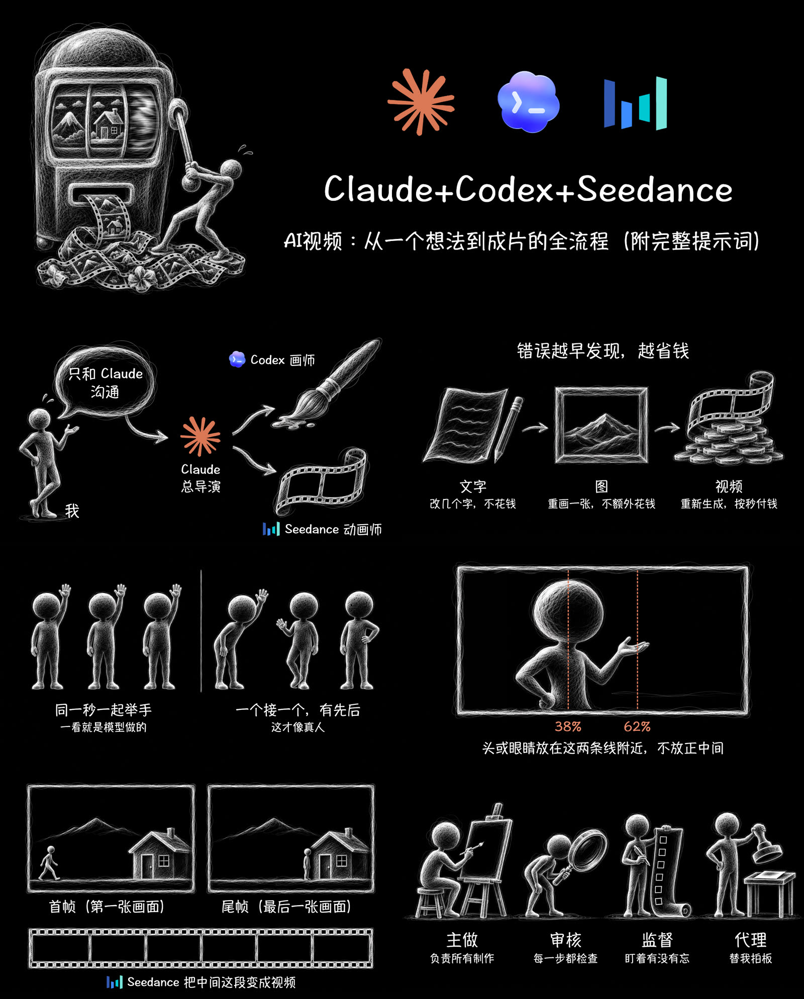
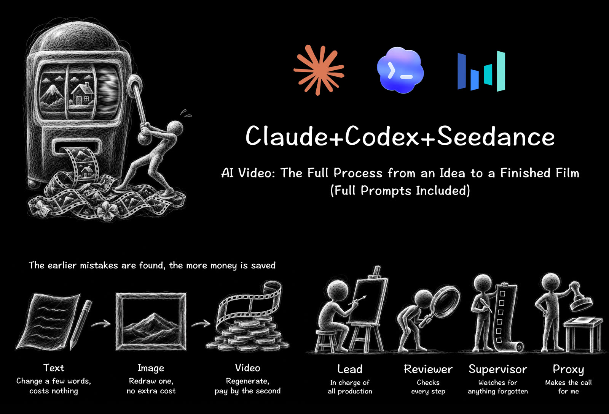

# eian-article-art

**黑板粉笔风的文章封面图和配图 · 给 Codex 和 Claude Code 用的 Skill（macOS）**

简体中文 · [English](README.md)

把一整篇文章交给 AI。它会自己挑出哪几处最需要图，先给你看清单和一张样图；你说可以，它再画完全部，并给你一份插好图的文章。



> 上图：一篇 1.2 万字的 AI 视频工作流长文，配了 1 张封面和 6 张图。

## 长什么样

- 纯黑底，白色粉笔乱线画出胖胖的圆头小人，没有脸。
- 字是手写体（Hannotate SC），白色。只有工具图标和要量东西的标注带颜色。
- 一张图只讲一件事，看一眼就懂。
- **字不是 AI 画的**，是用 HTML 加上去的，所以中文、英文都不会出现乱码或错字。

| 第二篇文章：5 个模块的结构图、7 步图 | 英文版 |
|:---:|:---:|
|  |  |

## 它会做什么

1. **读完全文，挑位置**：大约每 2000 字一张（英文每 1000 词一张），只挑读者光看文字很难想出画面的地方，比如分工、对比、对和错、比例、新名词。代码、表格和小故事不配图。
2. **先停一次**：给你一张清单（每张图放在哪段后面、画什么、写什么字），再加一张样图。你认可了才往下画。
3. **画图**：Codex 用自己的生图工具画，每张都带两张参考图（一张管小人，一张管线条），风格不会跑偏。
4. **加字、截图**：用 HTML 加字，再用 Chrome 截成 PNG。封面 2000×800，配图 1672×941。
5. **检查**：每张都看一遍，包括字有没有压到画、有没有贴边、风格是否一致。
6. **交付**：全部 PNG、清单，再加一份 `<文章名>_配图版.md`。原文一个字不改，只插图。原文里本来就有图的位置，会先问你要不要换。

## 安装

需要：
- **macOS**：字体 Hannotate SC 是 Mac 自带的，第一次用要在「字体册」里点一下下载。
- **Google Chrome**（Chromium 或 Edge 也行），用来截图。
- **Codex**：负责画图，要用 ChatGPT 账号登录。每画一张图，都会用掉你套餐里的生图额度。还没装 Codex 的话：

  ```bash
  npm install -g @openai/codex
  codex login
  ```

  （也可以用 ChatGPT 桌面版，里面自带 Codex。详见 [github.com/openai/codex](https://github.com/openai/codex)。）

**Codex**（推荐，Codex 自己就能画图）：

```bash
git clone https://github.com/YIAN6557/eian-article-art.git ~/.agents/skills/eian-article-art
```

**Claude Code**（画图时会调用你本机的 Codex）：

```bash
git clone https://github.com/YIAN6557/eian-article-art.git ~/.claude/skills/eian-article-art
```

两个都用的话，装到 `~/.agents/skills/` 里，再软链到 `~/.claude/skills/`：

```bash
mkdir -p ~/.claude/skills
ln -s ~/.agents/skills/eian-article-art ~/.claude/skills/eian-article-art
```

## 怎么用

直接跟 AI 说：

- 「帮我给这篇文章配图：文章.md」
- 「给这篇文章做个封面图」
- 「做张图说明这个：……」

**在 Codex 里有一步要你点同意**：截图要用 Chrome，Chrome 在 Codex 的沙盒里打不开。到这一步时，Codex 会请你批准在沙盒外运行截图命令；如果不能批准，它会给你一条命令让你自己跑。

## 文件夹

```
SKILL.md                 给 AI 看的说明：风格规矩、流程、检查清单
references/pick_spots.md 怎么从整篇文章里挑配图位置
references/publish_drafts.md  （可选）放进 X 文章、公众号草稿的方法
templates/               封面和配图的 HTML 模板、提示词模板
tools/codex_image2.sh    非 Codex 的 agent 用它调用 Codex 画图
tools/shot.sh            把 HTML 截成 PNG
assets/refs/             小人参考图
assets/logos/            Claude、Codex、Seedance 图标
examples/                认可过的完整例子：提示词、原图、HTML、成品
```

## 许可证

[MIT](LICENSE)。`assets/logos/` 里的 Claude、Codex、Seedance 图标属于各自的公司，只用来在图里表示这些工具。

作者：Eian（[@EianLu](https://x.com/EianLu)）
